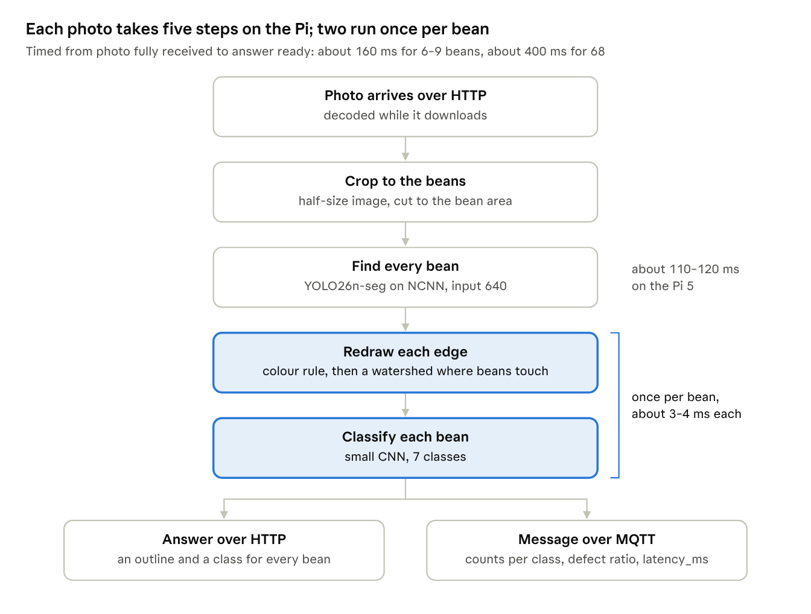
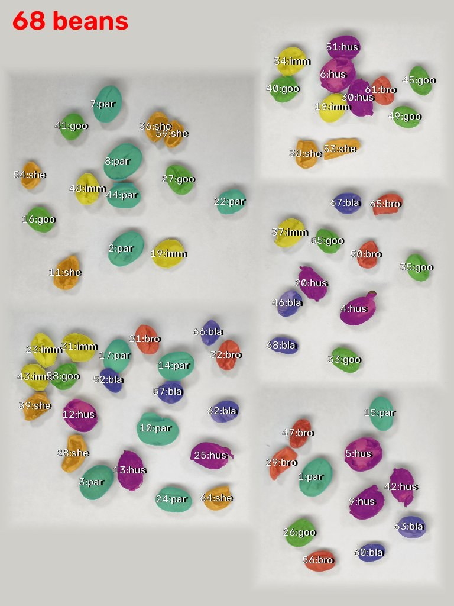

index always count from zero to one: Edge AI at TESA Top Gun Rally 2026

Team TGR-21 RTNA, Royal Thai Naval Academy · 20 November 2026

I started the week without ever having trained a model. Five days later, team TGR-21 RTNA won Edge AI Integration with 53.01 / 60, after 5 of 7 on Day 1 and 2nd of 56 on Day 2.

This repo holds the whole story:

- **This guide:** how each day went, what didn't work, and the lessons.
- **[`code/`](code/):** everything that ran on the Raspberry Pi 5 in the final test, with the trained weights. It is the exact build we submitted.
- **[`dataset/`](dataset/):** the simulated piles and stress tests I built, with exact masks and classes, and our results on the test photo.

## Results

Each day went better than the one before, and the last day carried 60 of the track's 100 points.

| Day | Task | Score | Rank on the dashboard |
|---|---|---|---|
| Day 1 (17 Nov) | Classify 7 bean types from photos | 10.71 / 15 (5 of 7 photos) | #3 |
| Day 2 (18 Nov) | Outline every bean in natural piles, on a Raspberry Pi | 22.91 / 25 | #2 of 56 |
| Day 3 (19–20 Nov) | Integration: a live client on the Pi with outlines and a class for every bean, sent over HTTP and MQTT, speed ranked | **53.01 / 60** | **#1** |
| Edge AI track | Days 1 + 2 + 3 | **86.63 / 100** | |

Day 1's #3 is the dashboard's score tier: 11 teams scored 7 of 7 and 19 scored 6 of 7. The Integration podium was TGR-21 RTNA first, TGR-03 Byte บุญ (RMUTI Isan) second and TGR-56 (Siam University) third. Edge AI counts for 26% of the overall competition.

## The challenge

The Edge AI track of TESA Top Gun Rally 2026 (KMITL Chumphon) asked for AI that judges Chumphon Robusta coffee beans on a Raspberry Pi, one stage per day, each building on the last. The seven bean classes were good, shell, black, husk, broken, parchment and immature.

| Stage | Input | Output | Scored on | Rules |
|---|---|---|---|---|
| Day 1 | Photos of one bean type each | The class of each photo | 7 test photos, all right = 15 | CNN only (no YOLO), Raspberry Pi 4 |
| Day 2 | Natural piles of beans | An outline (mask) for every bean | Mask IoU, bean count, speed | YOLO allowed, Raspberry Pi 5 |
| Day 3 | Photos sent live by the organisers' server | Outline + class for every bean, over HTTP; counts and timing over MQTT | Segmentation 15 (IoU > 0.90), classification 15, speed 25 (ranked), MQTT 5 | Two rehearsals, then a 15-minute test with 5 rounds |

## Day 1: classifying beans, and what 5 of 7 taught me

I got 5 of 7 test photos right (10.71 / 15). The two misses were the immature and parchment photos, the two pale classes that look most alike.

With only 21 training photos, I classified beans rather than photos:

1. Find every bean with OpenCV: separate the beans from the white paper, then put one centre on each bean with a distance transform, which also splits touching beans.
2. Cut a fixed window around each centre, so a bean keeps its true size, and shrink it to 96 × 96. That turned 21 photos into about 170 training crops.
3. Score each bean with a small CNN, blended 65 / 35 with a colour-and-size model.
4. Let the beans vote: the class with the most votes is the photo's class.

The lesson was about checking, not modelling. My validation used simulated piles and looked better than the real test turned out. From then on, I checked every change against real photos whenever I had them.

## Day 2: segmenting every bean, versions v2 to v12

Day 2 finished 2nd of 56 with 22.91 / 25, and the winning idea was precise edges. Plain YOLO masks scored almost nothing at a strict IoU of 0.95 (F1 ≈ 0.01) because the model's mask grid is too coarse; redrawing each edge from the photo itself fixed that.

The final version, v12, went in two minutes before the deadline:

1. Decode the photo at half size and crop to the area with beans.
2. Find beans with YOLO26n-seg (one class, "bean"), trained at 640 but run at 896 for a finer mask, on NCNN on the Pi.
3. **Colour rule:** snap each bean's edge to where the bean's colour meets the paper's, which leaves the shadow out.
4. **Contact watershed:** redraw the border wherever two beans touch, within 3 px of the contact (98% of near-misses were touching beans).
5. Clip each mask to its box and keep one solid piece per bean, so the polygon matches the mask.
6. Give the photo one class from the 12 largest beans.

Training data came from real photos plus simulated piles: beans cut out of the photos and pasted into new piles, with their masks known exactly.

| Version | Change | F1 @ IoU 0.95, normal piles | F1 @ IoU 0.95, big piles |
|---|---|---|---|
| v2 | First full pipeline | 0.684 | 0.546 |
| v3 | + contact watershed | 0.737 | 0.672 |
| v4–v9 | + clip to box | 0.754 | 0.689 |
| v10 | Model run at 832 | 0.773 | 0.741 |
| v11–v12 | Model run at 896 | **0.798** | **0.758** |

These held-out scores are optimistic, because the simulated labels used the same colour rule. On real hand-drawn outlines the masks reached a mean IoU of 0.965. One rule I'd drop: v12 held back beans it was unsure of, which cost points under a score that also counts beans; Day 3 kept every bean.

## Day 3: the integrated pipeline, the rehearsals and the test

Day 3 took 1st place with 53.01 / 60. The models mattered, but what won was a system that stayed fast and correct on the organisers' real server.

### Data and models

- **Segmenter.** The organisers gave 16 labelled photos of 6–9 beans each, with hand-drawn outlines. I cut their beans out and built 900 tight simulated piles (a quarter of them with 46–91 beans), fine-tuned the Day 2 model on a Colab A100 at 896, and exported it at 640 to NCNN for the Pi 5.
- **Classifier.** Three small CNNs, trained on Colab from Day 1 and Day 3 bean crops, with touching beans painted out and colours balanced to the paper. One network alone got 89.0% on Day 1 beans none of them had seen, and 97.6% on the 16 real Day 3 photos, which it had trained on. Averaging all three added only 0.3% for three times the time, so one was used.

### The client

One script did everything on the Pi: download each photo, outline and classify every bean, send the answer back over HTTP, and publish counts and timing over MQTT. Speed was scored from our own `latency_ms`, measured from the photo fully received to the answer ready.



The two per-bean steps are why a 68-bean photo took about 400 ms while a photo of 6–9 beans took about 160 ms.

### Rehearsals

- **First real run (19 Nov, 15:00): 2–3 s per photo, then a crash** on a broken 1 × 1 image hidden among the server's photos. Within half an hour: a bad photo could no longer stop a run, Wi‑Fi turned out twice as fast as the cable, turning off Wi‑Fi power saving halved the round trip, photos were decoded while still downloading, and the answer shrank to a third of its size. Server time fell to 0.52 s.
- **Speed work that afternoon:** the model went from 320 to about 205 ms per photo, with identical answers. Bean crops were cut straight from the photo, all beans were classified in one batch, a slow median became an exact histogram median, and the faster runtime was picked per machine. Warming up the whole pipeline before photo 1 removed a 50–90 ms first-photo penalty.
- **Rules changed mid-day:** classification became worth 15 points, so the stronger classifier went in (+4%).
- **Dress rehearsal (19 Nov, 20:00):** 50 photos with a median `latency_ms` of 160 ms (153–174 ms), every answer accepted and 50 of 50 MQTT messages delivered. Then the code was frozen.

### The test

The test was one photo of 68 beans, five training-style photos stitched together, sent in all 5 rounds. The pipeline found all 68 beans in every round, at 403 ms each, with every answer accepted and 5 of 5 MQTT messages delivered.



Our answer on the test photo: one colour per class, 68 of 68 beans.

Other teams reported about 150 ms on the same photo with single-model pipelines. Our extra time went into redrawing each bean's edge and classifying each bean separately. On simulated 68-bean piles, the edge redraw lifted outlines above IoU 0.90 from 62% to 86%; on this mostly spread-out photo the gain was smaller.

## What didn't work

Most ideas lost to measurement, and saying no to them was half the work.

| Idea | What happened | Kept? |
|---|---|---|
| INT8 segmenter | Less accurate, and slower on the Pi (124 vs 120 ms) | No |
| Smaller segmenter input (512 and 576; later 416 and 320) | 320 ran the segmenter about 3× faster but lost 1–5 points on dense piles | No, kept 640 |
| Looser duplicate removal (NMS 0.7–0.9) | Lost accuracy | No |
| Averaging three classifiers | +0.3% accuracy for 3× the time | No |
| Flipped copies at test time | Up to +0.8%, inconsistent, about 10% slower | No |
| Classifying 100+ beans in one OpenCV batch | 269 ms vs 189 ms one bean at a time with NCNN, on the Pi | No |
| Day 2: classifying every bean | 0.92–0.97 s per photo | Replaced by the 12 largest beans |
| Day 2: holding back unsure beans | Cost points once the bean count was scored | Dropped on Day 3 |

## Lessons

If I could brief myself on day zero, I'd say these eight things.

1. **Check on real data and the real device.** Simulated validation flattered me on Day 1; real labelled photos were the yardstick on Day 3, and every speed number came from the Pi itself.
2. **Learn exactly what the score rewards.** At IoU 0.95 plain YOLO masks scored almost zero, so edge precision decided Day 2.
3. **Rehearse end to end early.** The first real run found a crash and a 2–3 s delay that never showed up on my laptop.
4. **The network is part of latency.** Wi‑Fi or cable, power saving, decoding while downloading: each one cut real time.
5. **Test before you change, then freeze.** A smaller input looked like free speed until I tested it on dense piles.
6. **When speed is ranked, count the cost per bean.** The fastest teams paid for speed with one model; I paid time for edges and classes, and the score agreed with that choice.
7. **Make mistakes hard to make.** A typed YES before spending a real attempt, an exact check of the MQTT event name, answers that survive a bad photo, a way to re-send messages.
8. **Verify what you hand in.** Checksum the zip, and do a dry run of the exact build you submit.

## Reproduce it

Everything that ran in the final test is in [`code/`](code/), with the trained weights; its README lists every command. The dataset in [`dataset/`](dataset/) holds 24 simulated piles (430 beans) and 9 stress-test photos (871 beans), each with exact masks and classes, plus our results on the real test photo and the generator scripts.

```sh
cd code
pip install -r requirements.txt
python infer.py --input <photo folder> --weights weights/ --out outputs/
python client.py --dry-run --input <photo folder>
python gen_dataset_d3.py --day1 day_1 --day3 day3 --labels labels.json --out beans_d3 --d3-piles 900 --mixed 200 --d1-piles 10 --val-piles 60 --real-repeat 4 --big-frac 0.25
python train.py --data beans_d3/data.yaml --model runs/day2/weights/best.pt --imgsz 896 --epochs 60 --close-mosaic 10 --patience 25 --name day3 --export-imgsz 640
python train_cls_gpu.py final
```

The first two commands run the finished model on your own photos. The last three rebuild it; they need the organisers' Day 1 and Day 3 photos, which are not in this repo. `train.py` also documents stage 1, the Day 2 model this one starts from. A live run against a server needs a `team_config.json` with that server's details, which is not included.

## How I worked

I learned by building. I worked with Claude, Anthropic's AI assistant, as a coding partner: it wrote and tested much of the code with me, while I ran every experiment on the Pi, decided what to keep and what to drop, and ran the competition days.

Thanks to my team, TGR-21 RTNA from the Royal Thai Naval Academy, and to the TESA Top Gun Rally organisers at KMITL Chumphon. The beans in the dataset and the test photo come from photos the organisers provided.
